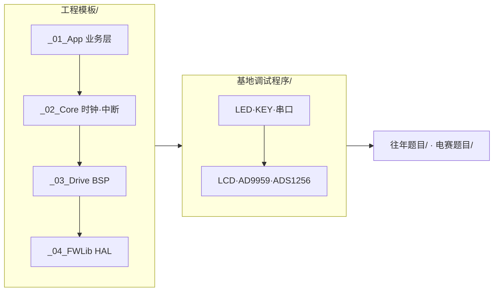

# STM32F4 工程集（STM32F407）

**模板、外设验证、历年赛题放在同一个仓里，clone 下来双击 `uvprojx` 就能编译**

[快速开始](#3-快速开始) · [常见问题](#5-常见问题) · [全部仓库索引](https://github.com/xhtfps/xhtfps)

## 为什么是这样一个仓库

散落在硬盘里的 Keil 工程，麻烦的从来不是写代码，而是半年后打开**不知道该从哪个文件改起**。这里按用途把 F407 的工程切开：`工程模板/` 是新工程的起手式，`基地调试程序/` 是一份逐外设的自检清单，`往年题目/` 只放赛题原文与方案、不掺代码。

## 亮点

- **模板就是起手式**：`_01_App`～`_08_USB` 八层已经分好，复制改名即可开工，不必再从零配时钟与串口重定向。
- **外设自检清单**：LED / KEY / 串口 / LCD / AD9959 / ADS1256 逐项跑通过，上板先过一遍能排除大部分硬件疑点。
- **题、码分离**：赛题资料与实现代码分目录存放，引用往届方案时不会把别人的整份工程拷进自己的仓。
- **可追溯的体积治理**：被移出的大文件在 `notes/offload.json` 留了 `base_commit`，随时可按原路径取回。

## 结构

## 1. 目录一览

| 目录 | 内容 |
| --- | --- |
| `工程模板/` | 基地通用模板：HAL 库 + BSP 驱动 + 分层目录（`_01_App`～`_08_USB`），新工程从这里复制 |
| `基地调试程序/` | 板级调试与自检程序（LED/KEY/串口/LCD/AD9959/ADS1256 等逐项验证） |
| `往年题目/` | 历届电赛题目原文与参考方案 |
| `电赛题目/` | 本届/校赛题目与器件清单 |

## 2. 软硬件环境

| 项 | 要求 |
| --- | --- |
| 开发板 | 正点原子 探索者 STM32F407（`atk_f407` 工程名，板载 TFTLCD、XMRAM） |
| MCU | STM32F407ZGT6（168 MHz / 1 MB Flash / 192 KB SRAM） |
| IDE | Keil MDK-ARM 5.36+，器件包 `Keil.STM32F4xx_DFP` |
| 调试器 | J-Link（推荐）或 ST-Link V2，SWD 四线 |
| 串口 | USART1，115200-8-N-1 |

## 3. 快速开始

1. 打开 Keil，`Project → Open Project`，进入具体工程目录，选择 `*.uvprojx`（如 `工程模板/atk_f407.uvprojx`）。
2. `Project → Rebuild all target files`。
3. 连接调试器，`Flash → Download`。
4. 串口助手（115200）看打印；模板默认会跑 LED 心跳与串口打印自检。

新工程起手式：复制 `工程模板/` 整个目录 → 改名 → 修改 `_01_App/User.c` 与 `main.c` → 保留 `_02_Core/_03_Drive/_04_FWLib` 不动。

## 4. 关键外设实践

- **AD9959**（四通道 DDS）：SPI + 多路 IO 更新，代码在 `_03_Drive/` 下，用于扫频、正弦/方波发生。
- **ADS1256**（24 位 ADC）：SPI 读取，配合基准电压做高精度直流测量。
- **TFTLCD / USB**：`_07_TFT_LCD`、`_08_USB` 为可选模块，不用的外设建议在工程分组中移除。

## 5. 常见问题

- **编译找不到头文件**：`Options → C/C++ → Include Paths` 里补 `_03_Drive`、`_04_FWLib` 子目录；路径避免中文。
- **下载失败 / 芯片被锁**：Keil `Flash → Configure Flash Tools → Debug → Settings` 里把 J-Link 速度降到 1 MHz，必要时用 ST-Link Utility 全片擦除。
- **AD9959 无输出**：先确认 `CS/SCLK/SDIO0-3/IO_UPDATE/P0-P3` 引脚与板级定义一致，再查 SPI 分频（建议 ≤10 MHz）。
- **中文文件名导致 Keil 报错**：目录名含中文时，Keil 5 在部分系统上会无法打开工程，可临时改为英文目录再编译。

## 6. 维护说明

- 被排除文件清单见 [`EXCLUDED_FILES.md`](EXCLUDED_FILES.md)（条目数、总体积与排除原因分布）；逐文件明细由 `tools/audit-git.ps1` 现场生成，不入库。
- 芯片手册等大体积 PDF 不进仓库：手册统一登记在 `notes` 仓的手册索引表，仓内只留链接与版本号。
- 同源旧仓库 `STM32project`（早期综合工程，仅 2 个源文件版本不同）已归档，等价内容在本仓库 `基地调试程序/` 内。
- 第三方库、芯片手册版权归原作者，仅作学习参考。

## 大文件去哪了

本仓已做过体积治理：大文件从当前分支移出，但历史提交完整保留，随时可取回。

- **完整台账**：[`notes/offload.json`](https://github.com/xhtfps/notes/blob/main/offload.json)（repo / path / size / base_commit），恢复命令与口径见索引仓 [`SLIM-PLAN.md`](https://github.com/xhtfps/xhtfps/blob/main/SLIM-PLAN.md)。

clone 后发现某个文件不在，按台账里的 `base_commit` 打开 `https://github.com/xhtfps/<repo>/blob/<base_commit>/<path>` 取回即可，不要重复提交进仓。

## 大文件去哪了

按 `SLIM-PLAN.md` 的口径做体积治理：以下文件**从 HEAD 移出、历史完整保留**。需要时按 `base_commit` 直链下载，不要重新提交进仓。

| 文件 | 体积 | 取回 |
| --- | --- | --- |
| `AD7606_global_asgn_op.abo` | 5.2 MB | [blob@a1d2146](https://github.com/xhtfps/stm32f4-projects/blob/a1d2146e421fb882b2ab7e3c3be14e31d942cdae/%E5%BE%80%E5%B9%B4%E9%A2%98%E7%9B%AE/AD7606%E6%A8%A1%E5%9D%97%E8%B5%84%E6%96%99-V3.2/%E5%8F%82%E8%80%83%E7%A8%8B%E5%BA%8F/FPGA/AD7606_FPGA/db/AD7606_global_asgn_op.abo) |

完整台账见 [`notes/offload.json`](https://github.com/xhtfps/notes/blob/main/offload.json)，恢复命令 `python tools/fetch-assets.py --repo stm32f4-projects`。

## 路线图

- [x] 工程模板与外设自检程序整理入库
- [x] 中间产物、IDE 缓存、芯片手册全部移出，历史可追溯
- [ ] 把各工程重复的 CMSIS 副本抽到 `bsp-libs`，仓体积再降一档
- [ ] 补一份「新工程从模板到第一次烧录」的十分钟图文指引

## 参与与反馈

- 遇到问题请走 [Issue 模板](.github/ISSUE_TEMPLATE)：带上板卡型号、Keil 版本、完整编译日志，缺信息的单子只能来回追问。
- 提 PR 前先读 [CONTRIBUTING.md](CONTRIBUTING.md)；安全问题按 [SECURITY.md](SECURITY.md) 私下反馈。
- 如果这个仓库帮你省过时间，点个 ⭐ 是最省事的支持。

## 许可证

本仓自写代码以 [MIT](LICENSE) 分发；ST HAL、CMSIS 与芯片手册版权归 ST 及原作者，仅作学习参考。
